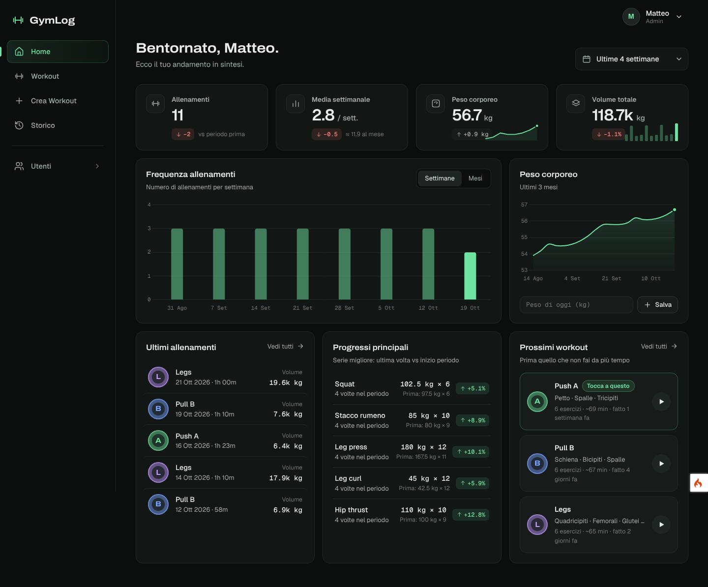
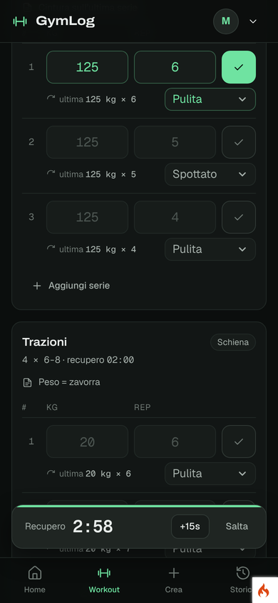

# GymLog

Una piccola webapp per segnare gli allenamenti in palestra e vedere come stai andando.
Fatta con **CodeIgniter 4** + **Shield** (login e ruoli), CSS e JavaScript senza framework.





## Cosa fa

- **Home:** allenamenti nel periodo, media settimanale e mensile, peso corporeo, volume, progressi principali, prossimo workout da fare
- **Workout:** scegli la scheda e segni kg/rep di ogni serie. Sotto ogni serie vedi cosa hai fatto **l'ultima volta**. Cronometro, timer di recupero, stati della serie (kippate, mezza rep, spottato…), bozza salvata nel telefono
- **Crea workout:** schede con esercizi, serie, rep obiettivo, recupero e note
- **Storico:** tutti gli allenamenti, con i record personali
- **Utenti (solo admin):** crea, modifica, blocca, elimina

## Avvio

```bash
composer install
cp .env.example .env          # poi metti i dati del tuo database
php spark key:generate
php spark migrate --all
php spark db:seed DatabaseSeeder
php spark db:seed DemoSeeder  # facoltativo: dati finti per vedere i grafici
php spark serve
```

Apri http://localhost:8080

| Email | Password | Ruolo |
|---|---|---|
| `ioelematteo@gmail.com` | `Matteo2026!` | admin |
| `user@test.it` | `User2026!` | user |

Cambia le password dopo il primo accesso (menu in alto a destra → Profilo).

## Test

```bash
vendor/bin/phpunit
```

## Documentazione

Tutto quello che c'è da sapere (architettura, database, scelte, dizionario di CodeIgniter) è in **[GUIDA.md](GUIDA.md)**.
